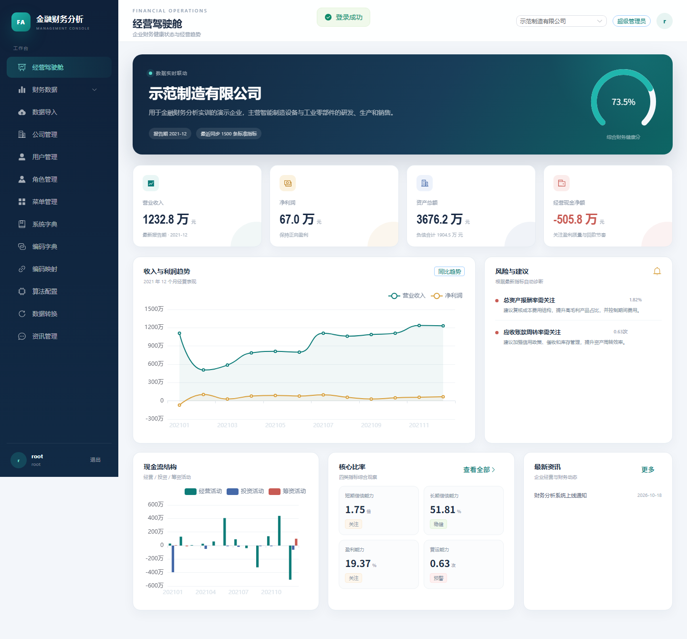

# 金融财务分析系统

一个面向企业财务场景的全栈实训项目，完成从 **金蝶 Excel 报表导入 → 编码映射 → 数据转换 → 财务指标分析 → 经营预测** 的完整数据链路。

项目同时提供三类客户端入口：

- **现代 Web 管理端**：Vue 3 + Element Plus + ECharts
- **原 JSP 管理端**：保留老师提供的后台页面，用于兼容和高级管理操作
- **uni-app 移动端**：经营报告、财务分析、损益预测和投资预测



## 项目简介

系统围绕财务数据仓库和经营分析展开，支持将资产负债表、利润表、现金流量表、科目余额表和账龄分析数据导入 MySQL，再通过标准编码映射生成统一指标，最终向 Web 端和移动端输出经营报告、财务比率、趋势图、风险提示和预测结果。

核心数据流程：

```text
金蝶 Excel 报表
      │
      ▼
原始报表宽表
      │  编码字典 + 编码映射
      ▼
标准指标结果表
      │
      ├── Web 管理端：报表、比率、趋势、预警
      ├── 移动端：经营报告、财务分析、预测
      └── 投资模型：NPV / IRR / 回收期
```

## 功能模块

### Web 管理端

| 模块 | 功能 |
| --- | --- |
| 经营驾驶舱 | 健康分、收入、净利润、资产、负债、经营现金流、趋势图、风险提示、资讯 |
| 财务数据 | 利润表、资产负债表、现金流量表、科目余额表、账龄分析 |
| 数据导入 | 单表导入、批量导入、按文件名识别报表类型和会计期间 |
| 公司管理 | 公司档案、法人、行业、负责人、报表标准 |
| 用户与权限 | 用户、角色、菜单、系统字典、密码重置 |
| 配置中心 | 编码字典、编码映射、算法配置、数据转换 |
| 财务分析 | 短期偿债、长期偿债、盈利能力、营运能力四类比率 |
| 资讯管理 | 企业经营与财务分析资讯 |

### 移动端

| 页面 | 功能 |
| --- | --- |
| 登录 | 账号密码登录、token 鉴权 |
| 经营报告 | 企业健康分、收入、利润、资产、经营现金流、风险建议 |
| 报表明细 | 利润表、资产负债表、现金流量表明细和月度趋势 |
| 财务分析 | 资产负债、利润、现金流、比率分析 |
| 账龄/科目 | 往来款账龄结构、科目余额查询 |
| 损益预测 | 历史收入趋势 + 未来期间预测 |
| 投资预测 | 增值税、折旧、借款还本付息、项目现金流、全资本现金流、NPV、IRR、回收期 |
| 个人中心 | 资料修改、企业信息、退出登录 |

## 技术栈

| 层次 | 技术 |
| --- | --- |
| 后端 | Java 8、Spring Boot 2.7、Spring MVC、JdbcTemplate |
| Web 管理端 | Vue 3、Vite、Element Plus、ECharts、Axios |
| 兼容管理端 | JSP、Ace Admin、Bootstrap、EasyUI |
| 移动端 | uni-app、Vue 2、Canvas 图表 |
| 数据库 | MySQL 8.0 |
| Excel | Apache POI 5.2.5 |
| 鉴权 | HttpSession（JSP）、token（移动端/新 Web） |

## 目录结构

```text
financial-analysis
├── backend/                  Spring Boot 后端、JSP 页面、移动端 API
│   ├── src/main/java/        Controller / Service / Config / Util
│   ├── src/main/resources/   application.yml、静态资源、演示数据
│   └── src/main/webapp/      JSP 管理端页面
├── web/                      现代 Web 管理端源码
│   ├── src/App.vue           管理控制台主页面
│   ├── src/api.js            管理端 API 封装
│   └── src/styles.css        控制台视觉样式
├── mobile/                   uni-app 移动端源码
├── sql/                      建库脚本、种子数据、编码/算法数据
├── demo-files/               用于现场演示的 Excel 样例
├── docs/                     API、验收、任务对照、审计和展示文档
├── tools/                    接口测试、环境检查、USB 转发、截图
└── legacy/                   GitHub 仓库中保留的旧版本项目
```

## 快速启动

### 1. 环境要求

- JDK 8
- Maven 3.6+
- MySQL 8.0
- Node.js 16+（仅开发现代 Web 时需要）
- HBuilderX（运行 uni-app 移动端时需要）

### 2. 初始化数据库

默认数据库配置：

```text
host: localhost
port: 3306
database: financial_analysis
username: root
password: 123456
```

执行：

```powershell
mysql -uroot -p123456 --default-character-set=utf8mb4 -e "source D:/code/CodexProgram/ShixunCode/financial-analysis/sql/financial_analysis.sql"
mysql -uroot -p123456 --default-character-set=utf8mb4 -e "source D:/code/CodexProgram/ShixunCode/financial-analysis/sql/seed_admin.sql"
```

首次启动会自动导入 `backend/src/main/resources/demo-data/2021` 下的 2021 年 12 个月样例报表，并生成数据转换结果。

### 3. 启动后端

```powershell
cd backend
mvn -B -DskipTests package
java -jar target\financial-analysis.war
```

访问地址：

```text
现代 Web 管理端：http://localhost:8006/web/
兼容 JSP 管理端：http://localhost:8006/admin/pc/login
健康检查：http://localhost:8006/api/health
```

### 4. 演示账号

| 账号 | 密码 | 说明 |
| --- | --- | --- |
| `root` | `123456` | 超级管理员 |
| `analyst` | `123456` | 财务分析员 |

### 5. 启动移动端

用 HBuilderX 打开 `mobile` 目录，修改 `mobile/common/config.js`：

```js
export const API_BASE = 'http://电脑局域网IP:8006'
```

电脑浏览器调试时可以使用：

```js
export const API_BASE = 'http://127.0.0.1:8006'
```

USB 真机调试可执行：

```powershell
.\tools\setup-adb-reverse.ps1
```

脚本会建立 `8006` 端口反向转发。手机端详细步骤见 [手机真机运行说明](docs/手机真机运行说明.md)。

## Excel 导入说明

系统支持：

- 利润表 / 损益表
- 资产负债表
- 现金流量表
- 科目余额表
- 应付、应收、预付、预收、其他应付、其他应收账龄分析

导入规则：

1. 从文件名中识别报表类型和 `YYYYMM` 会计期间。
2. 利润表按行次/项目名称映射本期数和本年累计数。
3. 资产负债表按左右两栏读取年初数和期末数。
4. 现金流量表按项目行次读取经营、投资、筹资活动。
5. 同一公司、同一期间、同一报表重复导入时先清理旧数据，避免重复。

可直接使用 [demo-files](demo-files) 中的样例文件。

## 主要接口

### 移动端业务接口

| 方法 | 路径 | 说明 |
| --- | --- | --- |
| POST | `/api/auth/login` | 移动端登录 |
| GET | `/api/home/report` | 企业经营报告 |
| GET | `/api/finance/overview` | 金融数据总览 |
| GET | `/api/report/profit` | 利润明细 |
| GET | `/api/report/balance` | 资产负债明细 |
| GET | `/api/report/cashflow` | 现金流量明细 |
| GET | `/api/analysis/ratio` | 四类财务比率 |
| GET | `/api/finance/aging` | 账龄分析 |
| GET | `/api/finance/detail/chart` | 指标月度趋势 |
| POST | `/api/forecast/profit` | 损益预测 |
| POST | `/api/investment/forecast` | 投资现金流测算 |

### Web 管理接口

`/api/admin/**` 提供驾驶舱、公司、用户、角色、菜单、字典、报表、导入、账龄、编码、算法、资讯和数据转换接口，统一返回：

```json
{
  "code": 200,
  "message": "success",
  "data": {}
}
```

完整清单见 [API.md](docs/API.md)。

## 测试与验收

```powershell
# 移动端接口冒烟测试
powershell -ExecutionPolicy Bypass -File tools\smoke_test.ps1

# 环境、Web、USB 转发检查
powershell -ExecutionPolicy Bypass -File tools\demo-check.ps1
```

已验证：

- 23 项移动端接口全部通过
- 现代 Web 登录、驾驶舱、公司、利润表、比率、导入、编码映射页面通过
- 12 期利润/资产负债/现金流量数据
- 659 条科目余额
- 336 条账龄分析
- 1,500 条标准转换结果
- 22 个 uni-app Vue 模板通过校验

详细记录见 [测试记录](docs/测试记录.md)、[验收说明](docs/验收说明.md) 和 [代码审计报告](docs/代码审计报告.md)。

## 项目状态

| 项目 | 状态 |
| --- | --- |
| 后端核心功能 | 完成 |
| 现代 Web 管理端 | 完成 |
| JSP 兼容管理端 | 完成 |
| 移动端 API | 完成 |
| 移动端页面 | 完成源码和模板校验 |
| 手机 APK/H5 构建 | 需使用 HBuilderX 执行最终构建 |

## 说明与限制

- 本项目是实训项目，密码仍使用 MD5，token 存储在内存中，不适合直接作为生产系统使用。
- 投资预测采用教学简化模型，未考虑营运资金垫支、残值税费等更细口径。
- 现代 Web 的用户权限树、字典明细和转换结果列表仍在 JSP 兼容端提供。
- 原始资料目录没有修改，所有新的代码和文档均在本目录中维护。

## 相关文档

- [API 清单](docs/API.md)
- [验收说明](docs/验收说明.md)
- [任务对照](docs/任务对照.md)
- [代码审计报告](docs/代码审计报告.md)
- [明天展示流程](docs/明天展示流程.md)
- [手机真机运行说明](docs/手机真机运行说明.md)
- [现代 Web 开发说明](web/README.md)

## GitHub 仓库

<https://github.com/LuxCariol/finance-analysis-system>
